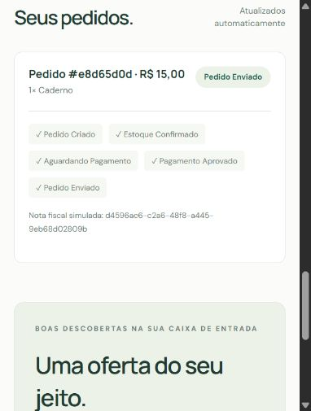

# Validação da implementação - 03/10/2026

## Resultado

Após a inclusão dos comentários e do espaçamento, os 26 testes e os oito cenários de integração com RabbitMQ real foram executados novamente e aprovados em 03/10/2026. A comparação das árvores sintáticas confirmou que os 32 módulos Python e os três scripts JavaScript preservam a lógica anterior. Também foram conferidos os elementos, atributos e textos HTML, os estilos CSS, a configuração YAML, as instruções Docker, as dependências, as variáveis de ambiente e os tokens do inicializador PowerShell. A evidência visual abaixo corresponde à execução original de 02/10/2026.

- **26 testes automatizados passaram**: regras, persistência, assinatura RSA, integridade/expiração do webhook, validação de entrada, endpoints, contrato HTTP do Resend sem envio real, filtragem de categorias e cancelamento de inscrições.
- **Teste de integração aprovado, código de saída 0**, com sete processos simultâneos e RabbitMQ real **4.3.5**, Erlang/OTP **27.3.4.17**. Foi usado broker nativo temporário, AMQP restrito a `127.0.0.1:5674`, sem painel de administração.
- Compilação dos módulos Python, sintaxe JavaScript, sintaxe do script PowerShell e `docker compose config --quiet` passaram.
- Interface verificada no navegador embutido do Codex: catálogo, sacola, criação de pedido, URL de checkout, aprovação pelo webhook e atualização até **Pedido Enviado** pelo SSE. O navegador disponível estava com largura aproximada de 397 px; a apresentação compacta ficou legível, sem erro de JavaScript registrado. Não foi validado visualmente um viewport desktop separado.

## Cenários da integração real

1. Inicialização dos sete processos, catálogo consultado por REST e especificação OpenAPI disponível.
2. Estoque confirmado, cobrança criada por REST, checkout, webhook, aprovação, nota simulada e envio. Repetir a aprovação não cria outra nota. Cancelamento após pagamento é rejeitado.
3. SSE inclui as mudanças exigidas, retoma pelo `Last-Event-ID` e os pedidos são filtrados por cliente.
4. Recusa de pagamento devolve a reserva de estoque.
5. Falta de estoque e cancelamento sem reserva duplicada.
6. Interesse em promoções consumido, mensagem registrada no modo de demonstração e cancelamento aplicado no serviço de Promoções.
7. Mensagem AMQP adulterada rejeitada, webhook sem assinatura rejeitado e consumidor continua processando pedido válido.
8. Estoque reiniciado preserva os saldos no SQLite.

O teste usa bancos temporários e encerra seus próprios subprocessos. Logs e o resultado JSON da execução ficam em `test-results/`, ignorado pelo Git. O encerramento no Windows trata também o interpretador filho do launcher de ambiente virtual.

## Evidência visual

## Limites da validação

- **Resend real não foi acionado**, pois não foram fornecidas credenciais. O contrato HTTPS foi testado com transporte isolado e a integração end-to-end usou `EMAIL_MODO=arquivo`. Configure Resend e demonstre recebimento na caixa de entrada para cumprir integralmente o requisito de API externa na apresentação.
- **A execução dos contêineres Docker não foi validada**: o Docker Desktop local não disponibilizava o daemon. A configuração do Compose foi validada, e os processos da aplicação foram testados localmente com broker real.
- Pagamento, nota fiscal e transporte são simulações acadêmicas. O UUID do cliente é um identificador de demonstração, sem autenticação.

As bibliotecas diretas estão fixadas em `requirements.txt`. Os testes HTTP locais emitiram aviso de depreciação do adaptador TestClient/httpx da versão instalada de Starlette; não houve falha nos testes.
